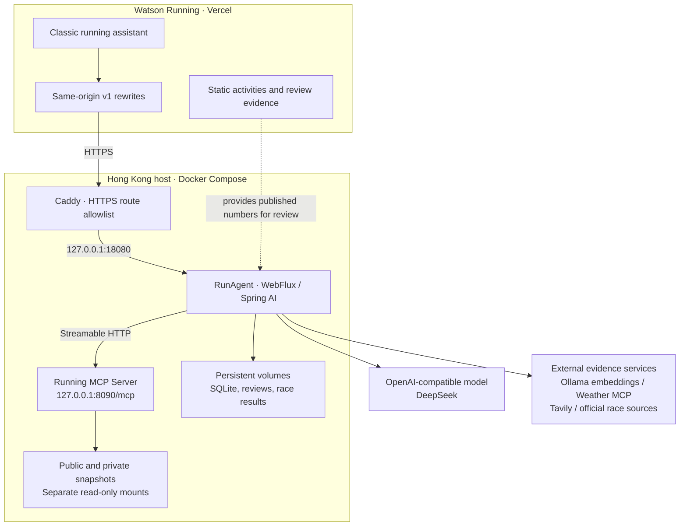
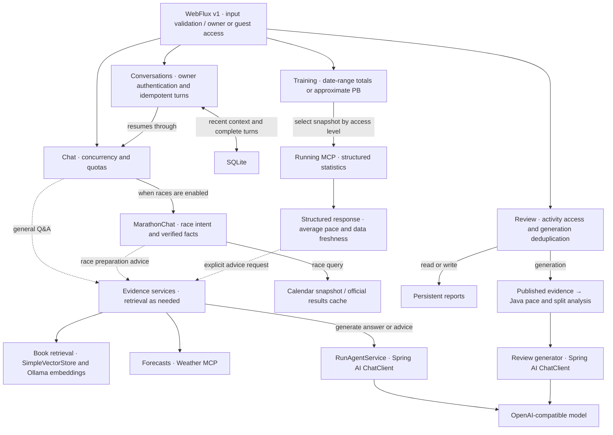

# RunAgent

[简体中文](README.md) · [Live site](https://run.watsonzhu.cn/) · [Watson Running](https://github.com/bells/watson-running) · [Running MCP Server](https://github.com/bells/running-mcp-server)

RunAgent is Watson Running's Java AI backend and an engineering project for tool calling, RAG, MCP, workflows, and multi-agent orchestration. The current build is `0.12.0-SNAPSHOT`. The site uses versioned APIs for Q&A, training statistics, race queries, and individual run reviews. The original development APIs let you exercise each execution path independently.

## Site capabilities

| Feature | Request and data source |
| --- | --- |
| Running Q&A | `POST /api/v1/chat` can combine running-book retrieval and Weather MCP forecasts. General answers use an OpenAI-compatible API. The Hong Kong deployment example uses DeepSeek |
| Training statistics | `POST /api/v1/training/stats` uses Running MCP for date-range totals or approximate personal bests. RunAgent derives average pace from total distance and duration. Visitors query a public snapshot. The owner token grants access to a separate private snapshot |
| Race calendar and results | The chat endpoint covers listed races in the next three months and verified official podiums. Visitors read bundled data and cached results. Owner verification and scheduled post-race backfill are configurable |
| Individual run reviews | `GET /api/v1/runs/{runId}/review` retrieves status or a saved report. `POST` generates a report from published numeric evidence. Visitors can use allowlisted activities |
| Conversation history | Guest history stays in the browser, which can include recent turns in chat requests. Once enabled, the owner can use `/api/v1/conversations` to list, read, resume, and delete conversations. Complete turns persist in SQLite |

Server settings control the versioned endpoints and anonymous access. The owner uses a Bearer token. Guest chat, training advice, and review generation have separate quotas. Frontend feature flags require matching server settings. [Deployment and configuration](deploy/README.md)

## Deployment architecture



In colocated mode, Caddy forwards allowlisted v1 routes. The application port, management port, and Running MCP are reachable over loopback. Model credentials stay on the server. Local development defaults to the in-process running data provider. In MCP mode, the separate service owns the activity snapshots. [Caddy routes](deploy/Caddyfile.example) · [Compose configuration](deploy/compose.mcp.yaml) · [MCP configuration](docs/mcp.md)

## How v1 requests execute



- Plain statistics use Running MCP results and deterministic calculations in RunAgent. When the user also requests advice, the model receives the stated goal and book or weather evidence. Queried mileage and pace are returned separately as structured statistics.
- Java reads race facts from the calendar snapshot and verified results cache first. When online verification is enabled, owner requests and the nightly job at 02:00 Asia/Shanghai can backfill official results. The job selects eligible events one to seven days after race day. Preparation questions can also include model-generated advice. [Race data and refresh rules](docs/marathon.md)
- Reviews use published numeric evidence for Java analysis and model generation, then save reports by access scope. Conversations, reviews, and verified results have separate storage. [Review and conversation operations](deploy/README.md)

## Development APIs and orchestration

`RUN_AGENT_LEGACY_API_ENABLED` controls these independent entry points. The colocated production configuration disables them.

| Endpoint | Execution path |
| --- | --- |
| `POST /api/chat`, `GET /api/chat/stream`, `POST /api/intent` | General Q&A, UTF-8 SSE, and structured intent output |
| `POST /api/agent` | ToolCallingAdvisor invokes allowlisted tools with call limits, a timeout, and bounded in-process conversation memory. [Tool calling](docs/tool-calling-flow.md) · [Memory](docs/memory.md) |
| `POST /api/knowledge/ask` | Standalone retrieval-augmented Q&A over the running-book index. [RAG](docs/rag.md) |
| `POST /api/workflows/training-analysis` | LangGraph4j selects Running and knowledge retrieval nodes by mode, then generates and validates the analysis. [Workflow](docs/workflow.md) |
| `POST /api/multi-agent/training-advice` | A supervisor delegates to the Running Analyst, Knowledge Coach, or Weather Advisor in a bounded graph and synthesizes their reports. [Multi-agent orchestration](docs/multi-agent.md) |

The multi-agent experiments include task-wide model call and output budgets, configurable routing, and usage tracking. Optional reliability controls provide dependency-scoped retries, circuit breakers, and concurrency limits. The workflow can independently enable in-process checkpoints. [Performance and cost](docs/performance.md) · [Reliability](docs/reliability.md) · [Metrics and tracing](docs/observability.md)

## Local development and verification

The stack uses Java 21, Gradle Wrapper 9.7.1, Spring Boot 4.1.1, Spring AI 2.0.1, and LangGraph4j 1.8.27.

```bash
./gradlew build
```

For live chat, copy the [local configuration template](application-local.yml.example) to `src/main/resources/application-local.yml`, or configure `AI_GATEWAY_BASE_URL`, `AI_GATEWAY_MODEL`, and `AI_GATEWAY_API_KEY` in the server environment. Start the app, then send the request from a separate terminal.

```bash
./gradlew bootRun --args='--spring.profiles.active=local --server.address=127.0.0.1'
```

```bash
curl http://127.0.0.1:8080/api/chat \
  -H 'Content-Type: application/json' \
  --data '{"message":"How should I warm up before a run?"}'
```

Regular builds use test doubles and synthetic data. Run the separate `evaluation`, `performanceBenchmark`, and `reliabilityVerification` Gradle tasks for offline verification. Live model evaluation is opt-in. [Evaluation guide](docs/evaluation.md)

## Operations and version history

- [Deployment, colocated MCP, snapshot updates, and rollback](deploy/README.md)
- [Synthetic training demo](docs/training-demo.md) · [Race calendar and official results](docs/marathon.md)
- The [v0.11 README archive](README.v0.11.md) preserves the progression from basic chat through reliability controls, including configuration, API examples, and verification notes.
