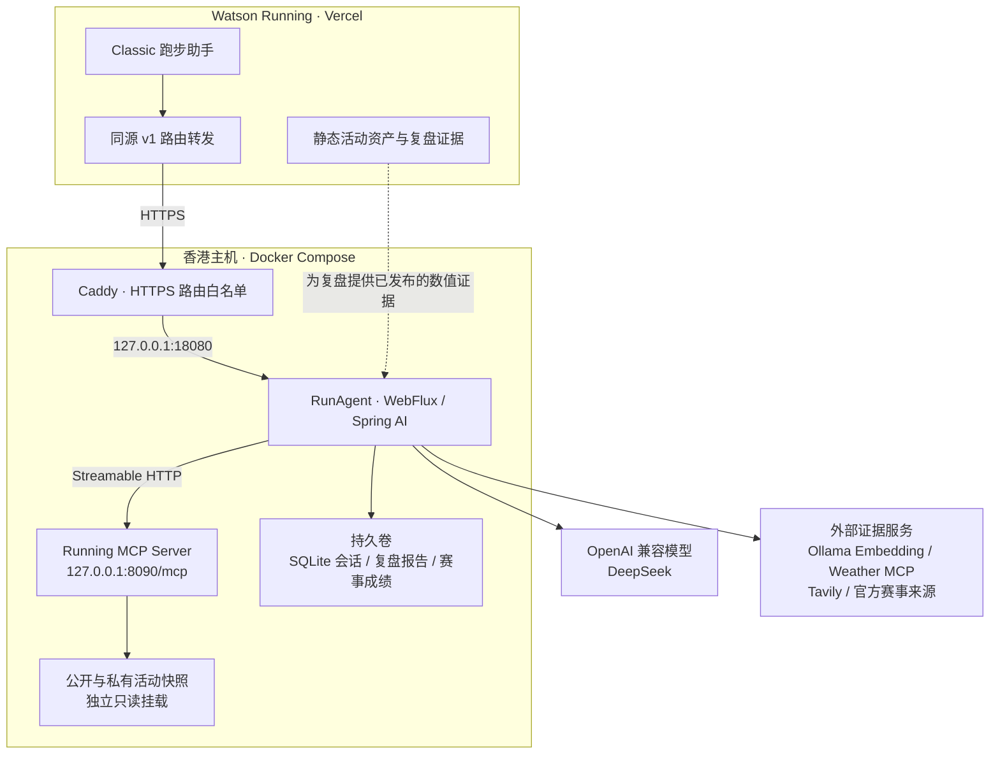
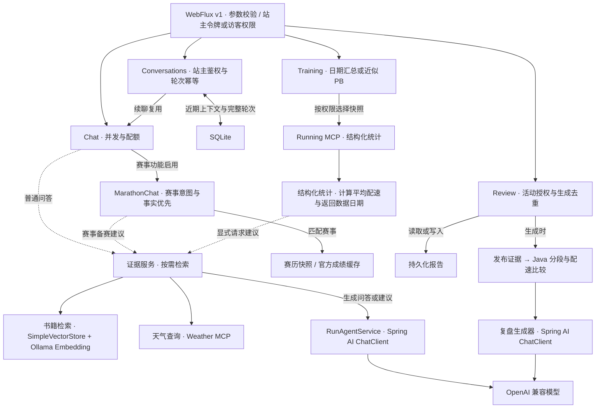

# RunAgent

[English](README-EN.md) · [线上体验](https://run.watsonzhu.cn/) · [Watson Running](https://github.com/bells/watson-running) · [Running MCP Server](https://github.com/bells/running-mcp-server)

RunAgent 是 Watson Running 的 Java 跑步 AI 后端，也是验证 Tool Calling、RAG、MCP、Workflow 和多 Agent 编排的工程项目。当前构建版本为 `0.12.0-SNAPSHOT`。站点通过版本化 API 使用问答、训练统计、赛事查询和单次跑步复盘，旧版开发接口用于独立验证各条执行链路。

## 站点能力

| 能力 | 请求与数据来源 |
| --- | --- |
| 跑步问答 | `POST /api/v1/chat`。可结合跑步书籍检索和 Weather MCP 预报，通用回答通过 OpenAI 兼容接口生成。香港部署示例使用 DeepSeek |
| 训练统计 | `POST /api/v1/training/stats`。Running MCP 返回日期汇总或近似个人最佳，RunAgent 由总里程与时长计算汇总平均配速。访客查询公开快照，站主令牌可查私有快照 |
| 赛事日历与成绩 | 复用聊天入口，查询已收录的未来三个月赛事和已核验的官方领奖台。访客读取种子与缓存，站主查证和赛后定时补采按配置启用 |
| 单次跑步复盘 | `GET /api/v1/runs/{runId}/review` 读取状态或已存报告，`POST` 生成。服务端读取站点发布的数值证据，访客只可使用白名单活动 |
| 继续对话 | 访客历史保存在浏览器，可随请求提交近期对话。启用后，站主用 `/api/v1/conversations` 列表、读取、续聊和删除，完整轮次持久化至 SQLite |

版本化接口和匿名访问均由服务端开关控制。站主使用 Bearer 令牌。访客问答、建议和报告生成各有配额。前端启用功能需要匹配服务端配置。[部署与配置](deploy/README.md)

## 部署架构



同机模式下，Caddy 仅转发允许的 v1 路由，应用端口、管理端口和 Running MCP 从回环访问。模型凭据留在服务端。RunAgent 的本地开发默认使用本地 Running 数据提供方，切换 MCP 后由独立服务持有活动快照。[Caddy 路由](deploy/Caddyfile.example) · [Compose 配置](deploy/compose.mcp.yaml) · [MCP 配置](docs/mcp.md)

## v1 请求如何执行



- 纯统计使用 Running MCP 结果和 RunAgent 的确定性计算。附加训练建议时，模型只接收用户目标和书籍或天气依据，查询得到的个人跑量和配速仍在结构化统计响应中单独返回。
- 明确的赛历或成绩事实优先由 Java 读取快照和已核验缓存。启用在线查证时，站主请求及北京时间 02:00 的定时任务可补采官方成绩。定时任务查找赛后第 1–7 天符合条件的项目；备赛问题可追加模型建议。[赛事数据与刷新规则](docs/marathon.md)
- 复盘将发布证据中的数值用于 Java 计算和模型生成，按访问范围保存报告。问答历史、复盘报告与成绩缓存各有存储边界。[复盘与会话运维](deploy/README.md)

## 开发接口与编排

以下入口由 `RUN_AGENT_LEGACY_API_ENABLED` 控制，同机生产配置关闭旧版接口。它们与站点 v1 请求是独立入口。

| 入口 | 执行链路 |
| --- | --- |
| `POST /api/chat`、`GET /api/chat/stream`、`POST /api/intent` | 普通问答、UTF-8 SSE、结构化意图输出 |
| `POST /api/agent` | ToolCallingAdvisor 调用白名单工具，带工具次数、超时与进程内有界会话 Memory。[工具调用](docs/tool-calling-flow.md) · [Memory](docs/memory.md) |
| `POST /api/knowledge/ask` | 独立知识问答，使用书籍索引和检索增强。[RAG](docs/rag.md) |
| `POST /api/workflows/training-analysis` | LangGraph4j 按模式选择 Running 和知识检索节点，再生成并校验分析。[Workflow](docs/workflow.md) |
| `POST /api/multi-agent/training-advice` | Supervisor 在有界图中委派 Running Analyst、Knowledge Coach 或 Weather Advisor，汇总报告后合成回答。[多 Agent](docs/multi-agent.md) |

多 Agent 实验有按任务共享的模型调用和输出预算、可配置路由与用量记录。可选故障治理提供按依赖隔离的重试、熔断与并发限制；Workflow 可独立启用进程内 checkpoint。[成本与预算](docs/performance.md) · [故障治理](docs/reliability.md) · [指标与链路](docs/observability.md)

## 本地运行与验证

使用 Java 21、Gradle Wrapper 9.7.1、Spring Boot 4.1.1、Spring AI 2.0.1 和 LangGraph4j 1.8.27。

```bash
./gradlew build
```

试用真实问答时，将 [本地配置模板](application-local.yml.example) 复制到 `src/main/resources/application-local.yml`，或在服务端环境中配置 `AI_GATEWAY_BASE_URL`、`AI_GATEWAY_MODEL` 和 `AI_GATEWAY_API_KEY`。然后启动并从另一终端发起请求。

```bash
./gradlew bootRun --args='--spring.profiles.active=local --server.address=127.0.0.1'
```

```bash
curl http://127.0.0.1:8080/api/chat \
  -H 'Content-Type: application/json' \
  --data '{"message":"跑前热身可以怎么做？"}'
```

常规构建使用替身与合成数据。独立的 `evaluation`、`performanceBenchmark` 和 `reliabilityVerification` Gradle 任务提供离线验证；真实模型评估需单独启用。[评估说明](docs/evaluation.md)

## 运维与版本演进

- [部署、同机 MCP、快照更新和回滚](deploy/README.md)
- [合成训练数据示例](docs/training-demo.md) · [赛事日历与官方成绩](docs/marathon.md)
- [v0.11 README 归档](README.v0.11.md)保留从基础问答到故障治理的各阶段配置、API 示例和验证记录。
