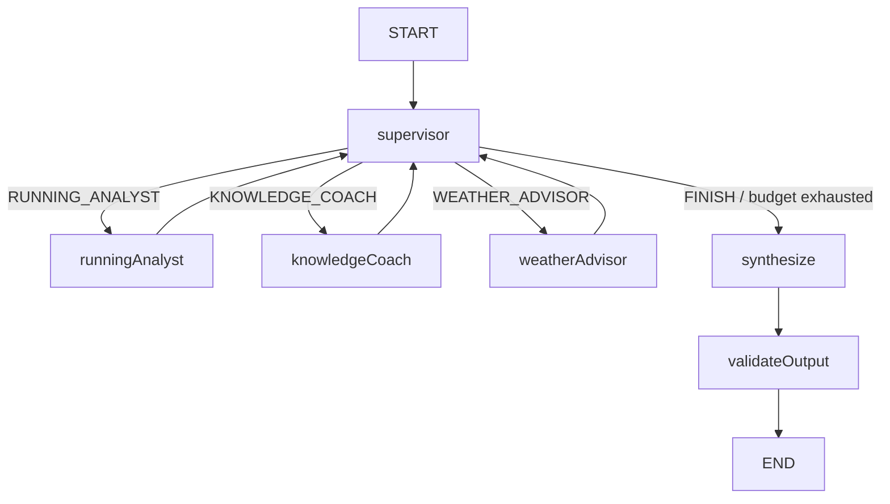

# RunAgent v0.9 Multi-Agent

## 1. What is Multi-Agent

本阶段采用 Central Supervisor Pattern。Supervisor 在明确的能力与预算边界内选择专业 Agent，接收报告，再形成统一建议。每个 Specialist 都有独立角色、System Prompt、输入子任务、ChatClient/LLM 调用、能力边界和压缩报告。

## 2. Why Multi-Agent

“结合个人训练、训练书籍和天气安排训练”包含三种独立证据来源。将职责分开可以限制每次模型调用的能力集合，分别观察延迟、失败和委派行为。Node 是 Graph action，Agent 是带角色与独立模型调用的执行单元。Java Node 包装 Agent 并负责交接。

## 3. When to use a single agent

简单的个人公里数或 PB 查询继续使用 `/api/agent`。多个 Agent 会增加模型请求、Prompt/Token、延迟、Cost、Trace 复杂度、Failure Modes 和 Evaluation 难度。职责分工清楚、确实需要多源证据时才使用本入口。

## 4. Supervisor Pattern

```text
             Supervisor
                 │
        ┌────────┼────────┐
        ▼        ▼        ▼
     Running  Knowledge  Weather
        │        │        │
        └────────┼────────┘
                 ▼
             Supervisor
                 │
                 ▼
              Answer
```

Supervisor 协调总体任务。它只能委派与汇总，没有 Running、VectorStore 或 Weather 工具。

## 5. Specialist Agent

RunningAnalystAgent、KnowledgeCoachAgent、WeatherAdvisorAgent 分别创建独立 ChatClient。三者复用配置的 ChatModel 连接，但不继承全局 ChatClient.Builder 的工具、QA Advisor 或 Memory 默认项。相同模型供应商不影响角色与能力隔离。

## 6. Delegation

路由模型使用 Spring AI `BeanOutputConverter<SupervisorDecision>` 生成 Java record/enum Schema 并映射结果。Decision 只有 `nextAgent` 和 `task`。Java 检查非空 enum、任务长度、能力可用性、已完成集合与预算。未知枚举、空决策、重复或不可用 Specialist 立即返回安全错误，没有自动重试。

## 7. Handoff

```text
Supervisor
    │
    ▼
Running
    │
    ▼
Supervisor
    │
    ▼
Knowledge
    │
    ▼
Supervisor
    │
    ▼
FINISH
```

Specialist 返回局部 State 更新，Graph 固定 edge 将控制权交回 Supervisor。新的 Supervisor 调用会看到状态和已压缩报告。Specialist 不选择下一位 Agent。

## 8. Shared State

| 字段 | 类型与更新 |
| --- | --- |
| executionId / question / location | String，override |
| startDate / endDate | LocalDate，override |
| availableAgents | List&lt;Specialist&gt;，override |
| nextAgent / delegatedTask | Specialist / String，override |
| delegationCount | int，override |
| completedAgents | List&lt;Specialist&gt;，distinct Appender |
| delegationPath | List&lt;String&gt;，允许重复的 Appender |
| runningReport / knowledgeReport / weatherReport | bounded String，override |
| runningStatus / knowledgeStatus / weatherStatus | SpecialistStatus，override |
| finalAnswer | String，override |

LangGraph4j 1.8.27 的 `Channels.appender` 默认去重。路径使用 `appenderWithDuplicate` 保留每次 Supervisor revisit。State 快照在当前 JVM 内克隆，没有配置 Saver。deadline 与取消标志通过本地 RunnableConfig metadata 传递，避免被克隆或误发给模型/MCP。

Shared State 只在一次执行中共享报告、状态和路径。Conversation Memory 会跨 HTTP 请求恢复消息。本入口每次生成独立 UUID，没有 conversationId 或 ChatMemory Advisor。

## 9. Centralized coordination

所有 handoff 都回到 Supervisor。集中控制可以统一预算、拒绝重复、隔离失败并审计路径。Peer-to-peer 网络需要进一步处理控制权、循环和跨角色上下文，本阶段没有此执行模式。

## 10. Multi-Agent and single-agent loops

v0.3 的一个 Agent 在多次模型请求之间选择多个工具。v0.9 的 Supervisor 在专业角色之间委派，每个 Running/Weather Specialist 内部仍可运行自己的 Tool Loop。

## 11. Tool Calling

Tool Calling 让 Agent 使用能力。Tool 是 schema-defined callback。Specialist 会理解任务、使用证据并生成报告，具有独立模型调用与职责。

## 12. Workflow

v0.7 根据 mode 确定 Running → RAG → Analysis 等路径。v0.9 的 Supervisor LLM 动态选择下一 Specialist，Graph 负责限制选择集合与交接边界。

```text
LLM Dynamic Decision inside Deterministic Graph Boundary
```

实际 Graph 在 Coordinator 构造时 compile 一次，多个请求共享 compiled graph，各自持有 State 和 Control。



## 13. MCP

MCP 标准化能力集成。Multi-Agent 组织多个专业角色协作。Running 和 Weather 可以通过 MCP 获得能力，Supervisor 的协作策略由 Host Graph 实现。

## 14. Running Analyst

独立 `running-analyst-agent-system.txt` 要求真实数据、禁止编造、保留 PB 整次活动近似口径。它只收到原问题、Running 子任务和日期提示。

工具只有 `getRunningSummary`、`getRecentRuns`、`getPersonalBest`。local 来自现有 RunningTools，mcp 来自 McpCatalog 的 running 连接快照。MCP 模式不创建 Host 本地数据 Service，不 fallback local，不重新发现。

ToolCallingAdvisor 运行真正的模型→工具→模型循环，复用当前 ToolCallingManager 的每工具4次、总8次限制及既有配置覆盖。Java 要求至少一次工具成功，超限、空答复、残留 Tool Call 或工具失败均不能发布 SUCCESS 报告。

## 15. Knowledge Coach

独立 Prompt 要求只解释提供的知识。它收到原问题、Knowledge 子任务与当前检索证据。Java 对子任务调用现有 `retrieveDocuments`，沿用索引、TopK、threshold、embedding 和检索观测，然后独立调用模型。

只有安全来源标题与正文进入本次模型 Context，标题最多200字符，证据总量最多12000字符。零召回或不可用不会调用知识模型。没有 Tool Calling、QuestionAnswerAdvisor、Running、Weather 或 Memory。

四本书仍通过 RAG_SOURCE_PATH 配置，沿用现有加载与 Reindex 规则。书籍、Chunk、索引和 manifest 保留本机隐私边界。

## 16. Weather Advisor

仅有 `openmeteo_search_locations`、`openmeteo_get_forecast`、`openmeteo_get_air_quality`。三项均在已过滤的 weather 连接快照中存在才可用。未启用 Weather 时应用和测试仍可运行。

Spring AI 2.0.1 的默认 MCP callback 只返回 content，而公共 Weather Server 0.5.0 将机器可读结果放在 structuredContent。Weather 对已通过官方 Provider/Filter 的 schema 使用同一 SDK client 执行类型化 CallToolRequest，优先返回 structuredContent，旧 Server 缺省时回退 content。每次工具只请求一次，metadata 固定为空。

它只收到原问题、Weather 子任务、location hint。地点来自这些显式输入，禁止由跑步历史 GPS 推断。Prompt 要求先搜索显式地点再使用搜索坐标，并考虑天气与空气质量。Java 要求至少成功取得非空 forecast 或 air quality，单独位置搜索不能成为天气证据。成功 geocoder 的坐标候选仅保存在本次 Host ToolContext trace；forecast/AQ 参数必须匹配这些候选，禁止跳过搜索或替换为其他地点。无法解析坐标或空天气 envelope 会安全标为不可用。多个同名候选中的选择与气象字段的语义正确性仍需要真实模型验收。

## 17. Capability Isolation

| Agent | Running | RAG | Weather | Memory |
| --- | --- | --- | --- | --- |
| Supervisor route / synthesis | 无 | 无 | 无 | 无 |
| Running Analyst | 三项 Running tools | 无 | 无 | 无 |
| Knowledge Coach | 无 | 显式 retrieval | 无 | 无 |
| Weather Advisor | 无 | 无 | 三项 Weather tools | 无 |

`runningSpecialistTools` 与 `weatherSpecialistTools` 单独注入。ToolSpecialistClient 校验完整工具名集合，拒绝混入其他能力。Supervisor 与 Knowledge 关闭 ToolCallingAdvisor 自动注册，并拒绝模型意外 Tool Call。

## 18. Structured Output and hints

```java
public record SupervisorDecision(Specialist nextAgent, String task) { }
```

枚举只有 RUNNING_ANALYST、KNOWLEDGE_COACH、WEATHER_ADVISOR、FINISH。没有 reasoning/thought 字段。FINISH 可以没有 task，但必须已有成功证据。

API 的两个日期要么都省略，要么同时存在。复用 RunningDateRange 校验 start ≤ end、含首尾最多366天。显式日期在工具 callback 前覆盖 Summary/Recent 参数，显式 location 覆盖位置搜索的 name。它们同时作为权威提示提供给模型。PB 工具沿用原有全历史语义，没有日期参数。

## 19. Bounded Loop

每个 Specialist 每次执行最多尝试一次，失败也标为 completed。Supervisor 重复选择会拒绝。达到 maxDelegations 后不再请求 Router LLM，有成功证据便直接进入 synthesis。

当已无可选 Specialist 时也直接结束委派，减少无意义的 Router 请求。没有成功证据时返回 `MULTI_AGENT_INSUFFICIENT_EVIDENCE`，汇总模型不会运行。

## 20. Delegation Limit

```yaml
run-agent:
  multi-agent:
    timeout: ${MULTI_AGENT_TIMEOUT:180s}
    max-delegations: ${MULTI_AGENT_MAX_DELEGATIONS:3}
    max-report-chars: ${MULTI_AGENT_MAX_REPORT_CHARS:2500}
    max-task-chars: ${MULTI_AGENT_MAX_TASK_CHARS:2000}
```

配置启动校验为正 timeout 且最多一小时，delegations 为1–3，report 为500–5000字符，task 为1–4000字符。180s 为多次模型和工具请求保留总预算，仍受一个全局 deadline 控制。

## 21. Context Explosion

三个专业角色会引入更多 Prompt、Token、中间信息、延迟和 Cost。Supervisor 只读取压缩报告，Specialist 的模型 Context 按角色投影。Running/Weather 的内部 Tool Loop 保留有限回合历史，完成后不把完整 transcript 放入 State。

## 22. Report Compression

Prompt 要求 concise report。Java 对非空报告强制 maxReportChars，按 UTF-16 长度截断并避免切断 surrogate pair。节点写入 State 前再次施加相同上限。报告保留证据摘要与不确定性，原始 Running JSON、RAG Document、Weather JSON、Prompt 与 ToolContext 不进入共享 State 或响应。

## 23. Failure Isolation

状态包括 NOT_RUN、SUCCESS、UNAVAILABLE、FAILED。缺失 capability 初始为 UNAVAILABLE。执行时工具/检索不可用映射 UNAVAILABLE，模型失败、无实际工具证据、空报告或超限映射 FAILED，随后回到 Supervisor。

路由决策不合法、Supervisor 模型故障、Synthesis 故障、无成功证据或全局 timeout 会整体失败。单个 Specialist 失败不会阻断其他仍有价值的能力。没有 Specialist 或 Graph retry。

## 24. Partial Success

例如 Running/Knowledge 成功而 Weather 失败，Supervisor 收到成功报告与 Weather 的 UNAVAILABLE 状态。Synthesis Prompt 要求明确说明实时天气不可用、天气因素未纳入建议，涉及缺失依据的结论保持条件性。

Java 检查至少一个 SUCCESS 和非空 finalAnswer。它不具备自然语言事实核验能力，报告压缩、合理归因、缺失说明与训练建议质量仍受模型影响。

## 25. Timeout and Cancellation

Controller 每次订阅创建独立 MultiAgentExecutionControl，在 boundedElastic 执行阻塞 Graph，使用 Mono.timeout 和 doOnCancel。每个 Graph action、模型调用与工具边界检查同一 control。

取消或到期后，即使当前 Provider 吞掉 interrupt，返回后也不能启动下一 Agent。超时属于 best-effort cancellation，已经启动的底层 HTTP 可能继续完成。业务 Observation 在内部执行实际结束时关闭，HTTP timer 可以先结束。

## 26. Observability

`runagent.multi_agent` 覆盖一次请求，`runagent.multi_agent.specialist` 覆盖实际开始的 route、running、knowledge、weather、synthesis 调用，`runagent.multi_agent.delegations` 每请求 finally 记录一次最终委派数。

低基数只有固定 specialist/outcome。multiAgentExecutionId 只作 high-cardinality span 属性或安全日志。Tool trace 仅记录 executionId、specialist、step、tool、status、latency。没有任务、问题、地点、报告、Chunk 或工具结果。沿用 AI error sanitizer、VectorStore 安全 convention 与内容采集关闭配置。

每个请求可能有多次 LLM call、多个专业阶段和多个 Tool Loop。HTTP latency 无法说明各阶段耗时或准确 Token Cost，需观察内置模型 usage 与实际 spans。实测树见验证文档。

## 27. Evaluation

`./gradlew evaluation` 增加7个固定日期合成 case，独立脚本驱动真实 Supervisor ChatClient、循环 Graph、ToolCallingAdvisor、本地 RunningTools、合成 Weather callbacks 和已有真实检索路径。

Delegation Accuracy 按实际 agentsUsed 与期望集合匹配，默认忽略顺序，ordered=true 时严格顺序。多余、缺少和重复委派都失败。Capability Isolation 读取实际模型请求的工具定义。Completion Accuracy 对比 Synthesis 实际收到的 SUCCESS 集合，防止错误 Specialist 状态被其他成功证据掩盖。

这些结果标记 `SCRIPTED_MULTI_AGENT_CONTRACT`，验证执行契约与失败语义。真实 Supervisor 路由质量需要独立 live 验证。Dataset/checksum 进入安全报告，问题、工具参数、报告与原始证据不进入报告。原有 Tool/RAG/Workflow 指标继续运行。

## 28. Security and Privacy

MCP callback 使用已有过滤快照、noOp metadata converter 和空委托 ToolContext。本地 MethodToolCallback 因 Spring AI 2.0.1 参数校验收到固定 requestType marker，trace 对象不传入旧 Agent trace。MCP 协议测试确认 CallToolRequest._meta 为空。

用户消息、工具结果、检索内容和外部工具描述都是不可信数据。角色 Prompt 与最小能力可减少影响，不能证明完全消除 Prompt Injection。当前应用仍为个人学习后端，没有生产认证。

## 29. Current Limitations

顺序执行固定三个 Specialist，启动时 capability 快照，单次请求状态，无 persistent checkpoint、长期 memory、retry、human approval、peer-to-peer handoff 或动态 Agent 创建。没有 Multi-Agent Streaming、并行、群聊、Skill Registry、在线 Judge 或生产认证。

## 30. API and Future Evolution

```bash
curl -X POST http://127.0.0.1:8080/api/multi-agent/training-advice \
  -H 'Content-Type: application/json' \
  -d '{"question":"结合个人训练、跑步知识与天气安排训练。","startDate":"2026-01-01","endDate":"2026-01-31","location":"深圳"}'
```

成功响应只有 executionId、delegationPath、agentsUsed、delegationCount、content。agentsUsed 按实际尝试顺序记录，失败尝试也计入预算。路径保留每次 supervisor handoff，末尾为 synthesize，输出校验节点不加入对外路径。

错误码统一 `MULTI_AGENT_*`。无效请求400、无效决策/执行失败502、依赖不可用/证据不足503、超时504。旧 API 合约独立保留。

后续如有需求，可分别评审真实模型委派 benchmark、重试幂等性、并行状态合并、持久化授权和人工控制。本阶段保留 Spring AI 2.0.1 与 LangGraph4j Core 1.8.27，现有 cycle/conditional edge 已满足范围。

### Provider timeout and cancellation behavior

Spring AI2.0.1底层OpenAI SDK有独立的自动重试默认值。RunAgent明确配置spring.ai.openai.max-retries=0，避免一次慢请求在SDK内部重复消耗全局预算。此默认作用于共用OpenAI-compatible模型网关，包括已有API；外部更高优先级配置仍可覆盖。

全局deadline仍默认180s。阶段模型失败时，在预算内返回Supervisor进行失败隔离；全局取消后，迟到异常在本请求的Callable边界结束，不进入Reactor的onErrorDropped路径。没有使用全局错误吞掉Hook。Root和阶段在异常路径也检查cancel/deadline，观测归类timeout。

Knowledge模型调用新增ragQueryId、phase=MODEL、STARTED/SUCCESS/FAILED和latencyMs日志，可用同一Trace或ragQueryId关联检索。问题、子任务、检索正文和报告不写入这些日志。
