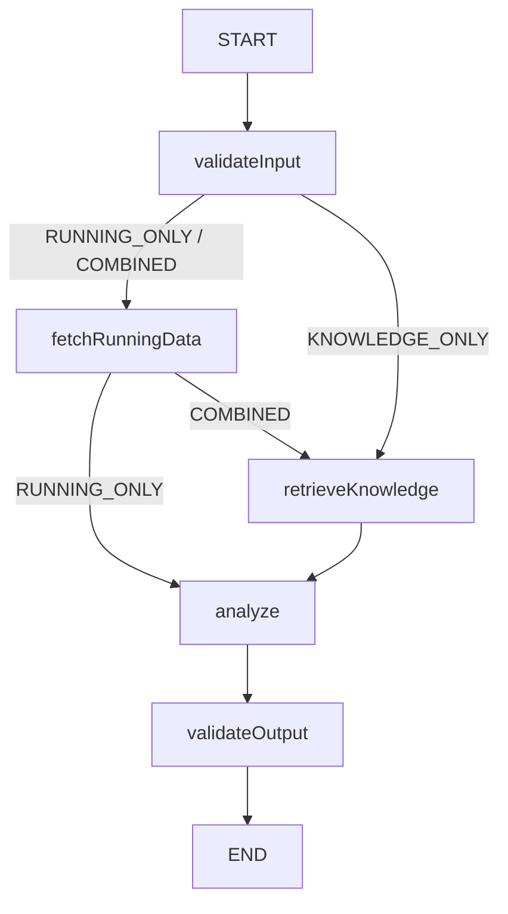

# RunAgent v0.7 — Workflow / LangGraph4j

## 1. 什么是 Workflow，何时使用

Workflow 由应用组织步骤与分支；节点可以调用 Java、MCP、RAG 或 LLM。它依然可以使用模型，区别在于下一步由谁控制。确定性要求高、流程明确或副作用风险高时，优先让程序明确控制。目标清楚但探索路径开放时，可以让 Agent 动态选择能力。

| 概念 | 解决的问题 |
| --- | --- |
| Tool Calling | 模型如何使用能力 |
| MCP | 能力如何标准化提供 |
| Agent Loop | 模型如何动态决定下一步 |
| Workflow | 应用如何确定性地组织多个步骤 |

`/api/agent` 的例子：“分析最近训练状态”。LLM 可以先请求 Summary，再根据结果决定是否获取 Recent Runs、PB 或继续行动。

```text
Goal → LLM → Action → Observation → LLM → ... → Answer
```

`/api/workflows/training-analysis` 的 `mode=COMBINED` 则强制 Running → RAG → Analysis → Java Validation；LLM 不能跳过任何必需步骤。这是 v0.3 的动态 Agent Loop 与 v0.7 的主要区别。

## 2. 版本、依赖与职责

2026-10-25 实际检查 [Maven Central metadata](https://repo.maven.apache.org/maven2/org/bsc/langgraph4j/langgraph4j-core/maven-metadata.xml)，最新 1.8.x 是 **1.8.27**。[官方支持分支](https://github.com/langgraph4j/langgraph4j/tree/support/1.8.x) 记录该版本、Java 17+；[主分支](https://github.com/langgraph4j/langgraph4j) 将 1.8.x 定义为 LTS，1.9.x 包含面向后续版本的实验特性。本阶段使用 Java 21，不需要 1.9.x。

只新增 `org.bsc.langgraph4j:langgraph4j-core:1.8.27`，不引入 agentexecutor、Studio、Saver 或 Spring AI Alibaba Graph。Core 负责 Graph orchestration；Spring AI ChatClient 负责模型调用，既有 Spring AI BOM 2.0.1 继续管理 Spring AI 版本。实际 runtimeClasspath 中 Core 仅增加 async-generator 4.3.1 和复用的 slf4j-api，没有 LangChain4j 或第二套 AI SDK。

## 3. State、Schema、Channel 与 Reducer

`TrainingAnalysisState extends AgentState` 表示一次执行的当前快照。它不是把 HTTP DTO 传给所有 Service，也不是对话存储。

| State key | 类型 | 更新语义 |
| --- | --- | --- |
| executionId | String UUID | override，本次执行唯一 |
| question | String | override |
| mode | WorkflowMode | override |
| startDate / endDate | LocalDate | override |
| runningSummary | RunningSummary | override |
| knowledgeEvidence | List&lt;KnowledgeEvidence&gt; | override，内部标题、分数、正文 |
| analysis | String | override |
| deadlineNanos | long | override，仅当前 JVM 执行期限 |
| executedNodes | List&lt;String&gt; | `Channels.appender`，累加成功节点名 |

Schema 把 key 映射到 Channel，Reducer 决定旧值和节点局部更新如何合并。覆盖 Channel 使用新值；Appender Channel 使 `validateInput` + `fetchRunningData` + `analyze` 累积为列表，节点不直接操作共享 List。执行失败的节点不会被追加为成功节点，失败状态在日志中记录。

1.8.27 默认 ObjectStreamStateSerializer 会为节点快照进行**内存克隆**，因此内部证据和 Summary record 实现 Serializable。没有配置任何 Saver，也没有将执行 State 写入磁盘；Serializable 不等于启用 Checkpoint。不能从不可信外部输入反序列化此 State。

COMBINED 的 State Flow：

```text
Initial: executionId/question/mode/dates/deadline
  → validateInput: executedNodes += validateInput
  → fetchRunningData: runningSummary = summary; executedNodes += fetchRunningData
  → retrieveKnowledge: knowledgeEvidence = evidence; executedNodes += retrieveKnowledge
  → analyze: analysis = model output; executedNodes += analyze
  → validateOutput: executedNodes += validateOutput
```

## 4. Node、Edge、Conditional Edge 和 Graph

Node 是执行一次明确职责的 action，返回 State 的局部更新。Edge 表示固定后继；Conditional Edge 用已知 mode 选择下一个节点。这里的节点不是 Agent：没有独立目标、规划或动态 Tool Loop。

实际 Graph：



图中的选择分支不并行执行。COMBINED 总是先 Running，再 RAG。

| Java Node | 职责与失败行为 |
| --- | --- |
| ValidateInputNode | 非空问题、最多 4000 字符、显式 mode；需要日期时成对提供、顺序正确、含首尾最多 366 天。复用 RunningDateRange，失败立即终止。 |
| RunningDataNode | Java 直接调用配置的 RunningCapabilityGateway 获取 Summary；没有 LLM Tool Selection。 |
| KnowledgeRetrievalNode | 生成独立 RAG queryId，调用 retrieveDocuments，把安全投影的证据写入 State；零召回、空正文或不可用立即失败。 |
| AnalysisNode | 从 State 构造安全 Context，只发出一次主要 ChatClient 调用；模型故障或请求 Tool 时失败。 |
| ValidateOutputNode | Java 检查 analysis 非空，按 mode 检查所需 Summary / evidence 存在；不是 LLM Judge。 |

TrainingAnalysisWorkflow 构造时构建 StateGraph 并 **compile 一次**，框架检查结构；每次请求生成 UUID 和 initial state，再 **invoke** 同一 compiled graph。三路径测试和并发测试验证实际执行顺序与请求隔离，不手写 while/switch Workflow Engine。

## 5. Running MCP 作为确定性能力

`RunningCapabilityGateway` 有两个真实实现，因此保留一个小接口：

```text
local: RunningDataNode → LocalRunningCapabilityGateway → RunningDataService → 只读 activities.json
mcp:   RunningDataNode → McpRunningCapabilityGateway → McpCatalog 已过滤 callback
                                                    → McpSyncClient → 独立 Running MCP Server
```

MCP 模式下 Host 不创建 RunningDataService / RunningTools，RUNNING_DATA_PATH 属于 Server。Java 已知道必须调用 getRunningSummary(startDate,endDate)，因此不需要模型选择工具。

McpCatalog 启动发现一次，并把通过现有 McpToolFilter 的 callback 按 connection/original tool name 保存。Workflow 只能查到已接受的 `running/getRunningSummary`；不会绕过白名单、重新 initialize/tools/list 或发手写 JSON-RPC。复用官方 SyncMcpToolCallback 和 noOp metadata converter，传入空 ToolContext；不附加 AgentExecutionTrace。

Spring AI 2.0.1 的 callback 返回 MCP content blocks 的 JSON，文本 block 的 `type` 可在 JsonHelper 序列化时省略。Gateway 只接受一个文本 block，解析其内部完整 Summary，检查字段类型、日期一致、数值非负且有限。`isError`、传输异常、error JSON、残缺字段或非法结果都转换为依赖不可用；错误对象不会成为模型证据。

## 6. RAG 作为显式 Retrieval Node

KnowledgeSearchService.retrieveDocuments(queryId, query) 和既有 search()/advisorStore() 共享 retrieve()、KnowledgeIndexService、SearchRequest、TopK、threshold 与安全日志。默认来自 `RAG_TOP_K=5`、`RAG_SIMILARITY_THRESHOLD=0.5`，不增加 VectorStore、Embedding 或 Retriever。

普通 `/api/knowledge/ask` 继续使用 QuestionAnswerAdvisor；Workflow 显式检索并把结果交给 Analysis，便于观察 Graph 控制检索。不会 HTTP 调用自己的 `/search`，也不使用仅有 preview 的调试响应。

知识源仍为四本书：丹尼尔斯经典跑步训练法、马拉松终极训练指南（原书第4版）、骨骼跑步法、跑步圣经（第2版）。源目录通过 `RAG_SOURCE_PATH` 配置，沿用 Tika/TextReader、TokenTextSplitter、Ollama bge-m3 和 SimpleVectorStore。加载现有索引无需读取或重新嵌入四本书；模型、内容或集合变化后仍须主动 Reindex。

KNOWLEDGE_ONLY / COMBINED 在关闭、索引故障、查询 Embedding 故障或零召回时 fail fast。加载索引成功不代表查询时 Ollama 一定可用；不能回退为模型常识并声称“根据四本书”。

## 7. Analysis Context 和安全边界

TrainingAnalysisContextBuilder 只投影 User Question、Summary 的区间/次数/公里/秒数，以及 KnowledgeEvidence 的来源标题和正文。按 mode 只放相应区块；不调用 DTO/Document.toString()，不带绝对路径、metadata dump、向量、GPS 或 Polyline。

Analysis 使用独立 ChatClient.builder(ChatModel)，不继承 Agent/QA 的 builder defaults，不注册 Tools、Memory 或 QuestionAnswerAdvisor，并通过 Spring AI 2.0.1 的 `TOOL_CALLING_ADVISOR_AUTO_REGISTER=false` 关闭自动 Tool Advisor。消息用 SystemMessage/UserMessage 传递，用户正文中的 `{}` 不被当作模板变量。

Prompt 位于 `prompts/training-analysis-workflow-system.txt`，由 PromptCatalog 加载。它要求事实与解释分开、个人数据只来自 Running Context、书籍归因有检索依据、证据不足明确限制、简短改写而不长篇引用、不暴露推理、不做医疗诊断、使用用户语言。Prompt 不是可证明的事实或版权校验器；Java 输出校验只检查存在性，不判断建议质量或医学合理性。

若 Chat 指向远程网关，汇总和召回片段仍会发给该网关；本地 Embedding 不代表生成也在本地。本次真实验收使用本地 Qwen，不发送个人跑量。

## 8. API 与失败处理

请求：`question`、`mode`、可选日期；无 conversationId。KNOWLEDGE_ONLY 可以两个日期都不传，提供时必须成对合法。RUNNING_ONLY / COMBINED 必须提供日期。Controller 做基础 Bean Validation；业务日期由 ValidateInputNode 检查。

```json
{
  "question": "结合最近训练汇总与书籍知识分析训练安排。",
  "mode": "COMBINED",
  "startDate": "2026-09-25",
  "endDate": "2026-10-24"
}
```

响应只返回：

```json
{
  "executionId": "<uuid>",
  "mode": "COMBINED",
  "executedNodes": ["validateInput", "fetchRunningData", "retrieveKnowledge", "analyze", "validateOutput"],
  "content": "..."
}
```

不返回完整 State、原始工具结果、检索正文、Prompt 或 Chain-of-Thought。所有必需步骤失败就停止，不继续调用后面的 RAG/LLM，没有 Retry、Compensation 或 Fallback Graph。

| HTTP | code | 含义 |
| --- | --- | --- |
| 400 | WORKFLOW_INVALID_REQUEST | HTTP 基础参数或业务日期非法 |
| 503 | WORKFLOW_DEPENDENCY_UNAVAILABLE | Running/MCP/RAG 必需证据不可用 |
| 502 | WORKFLOW_EXECUTION_FAILED | 模型失败、空输出或输出约束失败 |
| 504 | WORKFLOW_TIMEOUT | 应用 deadline 到期 |

## 9. Timeout、取消与 Trace

`run-agent.workflow.timeout=${WORKFLOW_TIMEOUT:60s}` 必须为正。Controller 使用 `Mono.fromCallable(...).subscribeOn(boundedElastic()).timeout(...)`；Graph/MCP/同步 ChatClient 不在 Netty event loop 执行。

这是 application deadline + best-effort cancellation，无法保证立即终止已经阻塞的 Provider HTTP 请求。每个订阅独立创建 WorkflowExecutionControl，期限从订阅时开始，Controller 的 doOnCancel 设置持久取消标记；它通过仅留在 Host 的 RunnableConfig metadata 传给节点，不放进被序列化克隆的 State，更不发送到 MCP。每个节点前后检查相同期限和取消标记，即使底层吞掉线程中断，也不会启动后续节点。State 的 deadlineNanos 只是当前执行期限快照。不实现 Retry、后台补跑或 Resume。

每节点安全日志格式示例（格式说明，不是某次真实请求结果）：

```text
workflowExecutionId=<uuid> node=fetchRunningData phase=STARTED
workflowExecutionId=<uuid> node=fetchRunningData status=SUCCESS latencyMs=...
workflowExecutionId=<uuid> node=retrieveKnowledge status=FAILED latencyMs=...
```

Workflow 不复用 AgentExecutionTrace，也不把 Node 伪装成 Agent Tool Step。executedNodes 只是学习/调试顺序，不是 OpenTelemetry Trace。`org.bsc.langgraph4j` 内部日志关闭，避免框架输出完整 State/异常数据。`org.springframework.ai.openai` 也关闭，因为 2.0.1 在空 choices 分支会以 WARN 记录完整 Prompt；本地假网关回归测试覆盖该路径。既有 MCP payload 日志禁用与 RAG 来源元数据日志边界保持不变。

## 10. Workflow State、Conversation Memory 与 Checkpoint

| 概念 | 生命周期 | 当前实现 |
| --- | --- | --- |
| Workflow State | 一次 Workflow execution | 本次 Summary、evidence、analysis、节点顺序 |
| Conversation Memory | 多个 HTTP 请求 / conversation turn | `/api/agent` 的 MessageWindowChatMemory，用于“那上个月呢？” |
| Checkpoint | 保存执行快照供以后恢复、Replay/Resume | v0.7 不启用任何 Saver 或持久化 |

State 存在不代表模型有对话 Memory；把 MessageChatMemoryAdvisor 加入 Analysis 会改变当前无状态契约。State 也不等于 Checkpoint。第 1、2 步成功、第 3 步崩溃时，没有 Checkpoint 必须重跑整个 Workflow；持久化快照可以成为恢复依据，但并非自动安全续跑。

LangGraph4j 支持 Checkpoint、Persistence、Resume、Replay，本阶段先学习 Graph Control Flow。未来加入时需要一起设计 Persistence、Execution Identity、Retry Policy、Concurrency、Side Effects 和 Idempotency。

例如 `Create Order → Pay → Notify`，Pay 成功后进程崩溃，恢复不能再次扣款。需要支付幂等键、外部确认与副作用边界，不能仅靠 State 标记。当前能力均为只读查询，模型生成仍有时间/计算成本；v0.7 不建设通用幂等或补偿机制。

## 11. Workflow Patterns 与后续演进

| Pattern | 含义 | 本阶段 |
| --- | --- | --- |
| Prompt Chaining | 上游数据/结果成为后续 Prompt Context | 实现“获取证据 → 构造 Context → Analysis”的顺序组合；只有一个主要 LLM 节点，不额外伪造三次模型链 |
| Routing | 按条件选择路径 | 实现显式 mode 的确定性 Conditional Edges |
| Parallelization | 独立节点并行后聚合 | 仅学习，不实现 |
| Orchestrator-Workers | 动态分解并派发子任务 | 仅学习，不实现 |
| Evaluator-Optimizer | 生成 → 评估 → 改进循环 | 仅学习，不实现；ValidateOutput 不是 LLM Judge |

这里不是严格的“多个 LLM Prompt 逐个串接”示例；展示的是顺序 Workflow 中上游证据对后续 Prompt 的明确依赖。后续有真实任务需要时再加入多个 Prompt。

Weather 仍是 v0.6 Agent 动态 MCP capability，保留过滤、隔离和 metadata 回归。当前不将地点、预报日期、空气质量并入训练 State，先固定 Running + Knowledge。五个节点没有独立 Agent 规划能力，不应命名 RunningAgent、KnowledgeAgent 或 SupervisorAgent。

v0.6 MCP 解决 Capability Integration（能力在哪里、如何调用）；v0.7 Workflow 解决 Capability Orchestration（能力按什么顺序执行）。下一阶段 v0.8 才学习 Evaluation Dataset、Tool Selection Accuracy、RAG Recall@K、Answer Relevance、Faithfulness、Metrics、Trace 和 OpenTelemetry；v0.9 才学习 Multi-Agent，当前均未实现。
